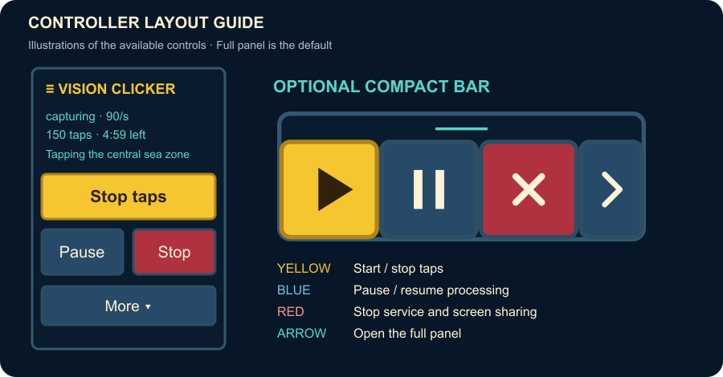
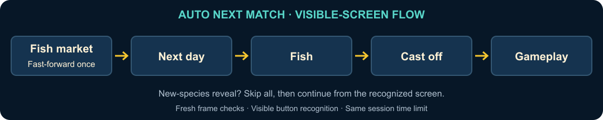

  

<h1 align="center">Vision Clicker</h1>

<strong>On-device fishing automation for Mas Dhoani.</strong> Offline recognition. Color-independent cues. Controls that stay within reach.

  
  
  

<a href="https://github.com/solah438-hub/Vision-Clicker/releases/latest"><strong>Download the latest APK</strong></a> · <a href="#quick-start">Quick start</a> · <a href="#controller-layouts">Controls</a> · <a href="#automatic-options">Automatic options</a>

> **Device-specific build:** configured for the Samsung Galaxy S23 Ultra **SM-S918B**, in portrait. It is not a universal Android auto-clicker.

## Overview

Vision Clicker analyzes visible game frames and sends Android accessibility taps when the correct cue appears. It recognizes the inner **!** and **X** shapes rather than maintaining a list of rarity colors or individual fish species.

This repository hosts app documentation, illustrations and ready-to-install APK releases. The game APK, private recordings, credentials and signing keys are not included.

| Game state | Vision Clicker action |
| --- | --- |
| **!** bite cue | Tap the sea center below the boat |
| Fight bar | Keep tapping at the selected repeat pace |
| **X** warning | Block fishing taps |
| Two-card power-up | Choose the left card promptly, regardless of grade |
| New-species reveal | Reveal and press **Skip all**, with Auto next match enabled |
| Fish-market results | Tap once to fast-forward loading, then wait for **Next day** |
| Visible trip buttons | Press **Next day → Fish → Cast off**, with Auto next match enabled |

## What's new in 1.0.19

- **Buttons follow the screen.** Next day, Fish and Cast off are located by their visible yellow surfaces and text. A scrolled-off heading or Back label is no longer required.
- **Start/resume-only auto-start.** The automatic path uses idempotent actions, so a repeated start signal cannot toggle running taps off.
- **Foreground recovery.** Briefly missing Android focus metadata blocks gestures while the game is rechecked, without immediately discarding the armed session. Known app changes still stop taps.
- **Optional compact bar.** Three color-coded controls and a full-panel arrow, saved as your preferred layout.
- **Smoother overlay.** Fixed-height status, throttled text updates, cached fonts and updated exclusion bounds reduce layout churn. A grip tap is distinguished from a real drag.
- **Clearer stop information.** The full panel shows remaining time and the current stop/wait reason; diagnostics record stop and pause reasons.

## Controller layouts

*Control-layout illustrations, not phone screenshots. Numbers shown are examples, not performance claims.*

The **Full panel** remains the default. Choose **Settings → Controller layout → Compact bar**, or **More → Compact controls**, to switch.

| Compact control | Action |
| --- | --- |
| **Yellow ▶ / ■** | Start or stop automatic taps |
| **Blue Ⅱ / ▶** | Pause or resume service processing |
| **Red ✕** | Stop the service and screen sharing |
| **›** | Open the full panel |
| Small top handle | Drag the controller |

Long-press a button for its action label. Moving, resizing or changing layout stops taps; press yellow again when ready. Keep the controller clear of the sea-center tap zone and menu buttons.

## Automatic options

Both options are **off by default** and can be enabled independently in Settings.

### Auto next match

The app fast-forwards the fish market **once**, waits for a visible Next day button, and follows the currently recognized trip screen. New-species reveals are dismissed before continuing.

Navigation uses fresh image evidence. A still-visible navigation button can be retried after **750 ms**; species skip prompts can be retried after **500 ms**. The market fast-forward remains once per round. Brief detection gaps are tolerated, and moving buttons must settle.

This uses the selected fishing ground and the **same session budget** across rounds. It does not rank power-ups or select upgrades.

### Auto-start on gameplay

While an approved screen-sharing session is active, a confirmed new round can start or resume taps automatically.

- **Pause** holds the current round. With this option enabled, a confirmed round-menu-to-gameplay transition can resume it.
- Paused sessions use limited passive checks for a new round.
- **Stop** ends sharing and automatic work.
- A reached time limit cannot create another budget automatically. Start a new session or explicitly press Start taps to continue.

## Quick start

1. Download **`VisionClicker-1.0.19-debug.apk`** from [Releases](https://github.com/solah438-hub/Vision-Clicker/releases/latest).
2. Update-install over the existing app to preserve its settings.
3. Open Vision Clicker and complete **Setup checks**: Accessibility connected and floating-controller permission allowed. Notifications are optional and provide another Stop control.
4. Select the repeat pace, session limit and optional automation settings. Defaults are **15 repeats/s** and a **five-minute** limit.
5. Tap **Start session** and accept Android's full-screen sharing prompt.
6. Use the yellow **Open Mas Dhoani** button. Start taps from the floating controller, or begin a new round with Auto-start on gameplay enabled.

A fresh sharing approval is required after Stop, a locked screen or a revoked capture session. Start a fresh session after installing an update.

## Settings and behavior

| Setting | Available behavior |
| --- | --- |
| Repeat speed | 5, 10, 15 or 20 repeats/s; actual pace depends on fresh frames and Android gesture completion |
| New bite | A new ! after a confirmed gap receives first-tap priority, with minimum spacing |
| Session limit | 1, 5 or 30 minutes; continues across automatic next-match menus |
| Maximum processing | Check available frames during active monitoring |
| Balanced processing | Check up to ten frames per second |
| Controller layout | Full panel or saved Compact bar |

Opening the app, leaving the game, or changing the controller layout stops armed taps. A gesture already accepted by Android may finish after Stop. Return to the full panel to inspect the current stop reason.

## Compatibility and privacy

- **Supported model:** Samsung Galaxy S23 Ultra SM-S918B, ARM64.
- **Orientation:** portrait, matching the configured 720 × 1544 reference geometry.
- **Android:** minimum API 36; the development device runs Android 17.
- **Access:** Accessibility gestures, display-over-other-apps permission and per-session MediaProjection sharing.
- **Processing:** on the device. No INTERNET permission, analytics, cloud recognition, account or root requirement.

The downloadable APK is **development-signed** to remain compatible with earlier personal builds. It is not a Play Store release or a general-device build.

## Validation and known limits

The 1.0.19 build passes **77 JVM tests**, with **zero lint errors** and a verified APK V2 signature. Saved-image checks cover recorded cues, different glyph colors and contrast, card layouts, scrolled/shifted buttons and bottom-edge buttons. Checksum files are attached to the release.

These checks do not guarantee every catch or establish long-session reliability. Rare interruptions remain under manual investigation; the full panel and diagnostic logs now expose the stop reason. A future game update or substantially different cue design may require recognition changes.

This project is not affiliated with Mas Dhoani's developer. Third-party components retain their licenses; Pixelify Sans is redistributed with its bundled SIL Open Font License notice.

